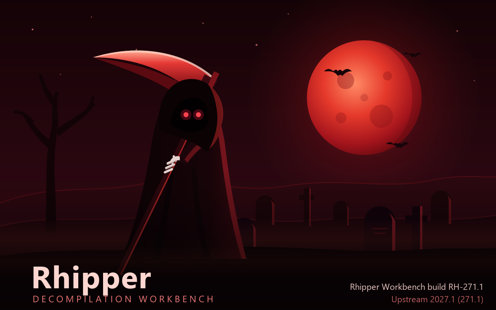

[](https://github.com/zeruth/Rhipper-IDE/actions/workflows/rhipper-release.yml)
[](https://github.com/zeruth/Rhipper-IDE/releases/latest)



# Rhipper Workbench

Rhipper Workbench is a free IDE to decompile a Windows program and recompile it as C that builds and runs.
It puts the [Rhipper](https://github.com/zeruth/Rhipper) pipeline, Ghidra, a C toolchain and an AI assistant in one window.

The goal is a full replacement for Ghidra and IDA Pro, for the work that comes after the disassembly:
a port that you can read, change, build and compare with the original program.

## How the parts fit

| Part | What it does | What the workbench adds |
|---|---|---|
| [Rhipper](https://github.com/zeruth/Rhipper) | Reads facts off the PE file, drives Ghidra, and translates the decompiled corpus to C that compiles. | Buttons for each pipeline step, the status of each step, and managed installs and updates of Rhipper. |
| [Ghidra](https://github.com/NationalSecurityAgency/ghidra) | Analyzes and decompiles the program, headless. | A managed install, and links from each generated function to its address. |
| [IntelliJ Platform](https://github.com/JetBrains/intellij-community) | The editor, the C language server client, the Build and Run tool windows, version control and the terminal. | The Rhipper product: a focused IDE with no Java tooling, the Blood Moon theme, and the Rhipper plugin. |
| AI, through MCP | An assistant such as Claude reads and changes the project. | An MCP toolset for the project, and a bundled Claude skill that teaches the workflow. |

Rhipper stays a Python tool. It uses capstone, unicorn, pefile and numpy, and it changes fast.
The workbench calls it, shows its results, and keeps it up to date.

## What it can do

**Run the pipeline.** Each step has a button beside the Run widget: facts, Ghidra, translate, build and test run.
A drop-down runs the pipeline from any step to the end. The Rhipper tool window shows the status of each step.

**Build the port.** Build, Rebuild and Clean Port run CMake through the Build tool window.
The tree shows each target, and each MSVC or linker error and warning is a link to its source line.
The console shows a file counter, such as `[ 30/400] translated_000.c`, and styled milestones.

**Run and compare.** The Port (Release), Port (Debug) and Reference run configurations start the port or the original program.
A port run builds first. The side processes in `run.with`, such as a local server, start and stop with the program.

**Read the corpus.** Find a function by name, address or fidelity. Go from a generated C function to its address, its callers and its references.
The Fidelity view lists the functions under a threshold and the changes since the last run.

**Edit C.** clangd gives completion, navigation and diagnostics for the generated and the hand-written sources.

**Start a project.** File | New | New Rhipper Project reads the PE headers of the reference binary.
It fills in the architecture and the image base, and shows the entry point, the subsystem, the linker, the sections, the imports and the PDB.
It warns when the entry point looks packed.

**Get the tools.** The first launch installs Rhipper, Python, Ghidra and clangd into `~/.rhipper`, and shows the progress of each download.
A missing JDK or CMake gets a notification with a download link.

## AI and MCP

The workbench has an MCP server. An assistant such as Claude can use these tools on the open project:

- Run a pipeline step, and read its result.
- Query the functions by name, address range or fidelity, and poll the functions under a threshold.
- Read a function: its C, its disassembly, its callers, its references and its clangd diagnostics.
- Read a fidelity summary, the fidelity changes and the port runs.
- Run a Rhipper script, and open a file or an address in the editor.

To use it, turn on Settings | Tools | MCP Server. Then add the bundled Rhipper skill to the project.
The skill tells the assistant how the pipeline works and which tool to use for each task.

## Install

Download the installer from the [latest release](https://github.com/zeruth/Rhipper-IDE/releases/latest):

| File | For |
|---|---|
| `Rhipper-Workbench-<version>-windows-x64-setup.exe` | The installer for Windows on x64. |
| `Rhipper-Workbench-<version>-windows-x64.zip` | The same IDE with no installer. |
| `Rhipper-Workbench-<version>-windows-arm64-setup.exe` and `.zip` | Windows on ARM64. |

Each file has a `.sha256` file to check the download.
The installer has no code signature yet. Windows SmartScreen shows a warning: select **More info**, then **Run anyway**.

A version is `UPSTREAM.BUILD`. `UPSTREAM` is the IntelliJ Platform major version that the release is built on, and `BUILD` is the Rhipper build number.

## Get started

1. Open a folder that has a `rhipper.json`, or make one with File | New | New Rhipper Project.
2. Let the IDE install the tools that are missing. Tools | Rhipper | Tools shows their status.
3. Run the pipeline with the buttons beside the Run widget.
4. Build the port with Build | Build Port (Ctrl+F9), and start it with the Port (Release) run configuration.

The Rhipper README lists every `rhipper.json` setting.

## Roadmap

- **One shared syntax tree.** The pipeline steps share one tree, with no text between them.
- **Ghidra in the IDE.** The analysis runs inside the workbench, not as a separate process.
- **Side-by-side stepping.** Step through the reference and the port together to find where they diverge.
- **More toolchains and languages.** More compilers in, and more languages out of the syntax tree.
- **Updates in the IDE.** The IDE finds a new release and updates itself.

## Build from source

You need Windows, Git, and the tools of the [IntelliJ Community build](https://github.com/JetBrains/intellij-community#building-intellij-community-from-source).

```powershell
git clone https://github.com/zeruth/Rhipper-IDE.git
cd Rhipper-IDE
# the build needs JetBrains' android repository at the revision in rhipper/android-revision.txt
git clone https://github.com/JetBrains/android.git android
git -C android checkout (Get-Content rhipper/android-revision.txt)

./rhipper.ps1                    # build and start the IDE
./rhipper.ps1 -Regenerate        # after a change to an .iml file or to the run configuration
./rhipper-installer.ps1          # build the installer into out/rhipper/artifacts
```

The Rhipper plugin is in `plugins/rhipper`, and the product is in `rhipper/ide`.

### Release

A push to `main` runs `rhipper-release.ps1` in CI. When the tag for `version.txt` does not exist, CI builds the installers and publishes a release.
To make a release, increase the number in `version.txt` and push.
`./rhipper-release.ps1` without arguments builds the same files locally, and publishes nothing.

## Upstream and license

Rhipper Workbench is a fork of [JetBrains' IntelliJ Community](https://github.com/JetBrains/intellij-community).
It is not made or endorsed by JetBrains. IntelliJ and the JetBrains names and logos are trademarks of JetBrains s.r.o.

The code is under the [Apache License 2.0](LICENSE.txt). A file that the fork changes has a notice at its top.
[`rhipper/ide/RHIPPER-NOTICE.txt`](rhipper/ide/RHIPPER-NOTICE.txt) lists the fork's notices, and the IDE ships it with the upstream notices.
